# KFT Automation Framework (`fe-automations`)

An enterprise-grade End-to-End (E2E) test automation and orchestration platform for **Knight Fintech (KFT)** applications, covering **LOS (Loan Origination System)**, **LMS (Loan Management System)**, **Screen Journey**, **DataBase connection & uses**, **API Automation** , and administrative approval workflows (L0, L1, L2, L3, SuperAdmin).

---

## 📑 Table of Contents

- [Overview](#-overview)
- [Tech Stack](#-tech-stack)
- [Repository Structure](#-repository-structure)
- [Prerequisites](#-prerequisites)
- [Installation & Setup](#-installation--setup)
- [Environment Configuration](#-environment-configuration)
- [Test Execution Guide](#-test-execution-guide)
  - [Playwright CLI Execution](#1-playwright-cli-execution)
  - [Headed & Debug Modes](#2-headed--debug-modes)
  - [Viewing Test Reports & Traces](#3-viewing-test-reports--traces)
- [Interactive Runners & Dashboards](#-interactive-runners--dashboards)
  - [Express Runner Server](#option-a-express-runner-server-port-3000)
  - [Interactive Web Terminal & Dashboard](#option-b-interactive-web-dashboard-port-3001)
- [Supported Test Journeys](#-supported-test-journeys)
- [Troubleshooting & FAQs](#-troubleshooting--faqs)
- [Maintainers & Support](#-maintainers--support)

---

## 🔍 Overview

This framework automates complex end-to-end banking and lending lifecycle journeys:
- **Debt Pool Upload Journey**: Dynamic batch creation, Excel lead injection, deduplication, KYC verification, BRE rule execution, approval through L0/L1/L3 hierarchies, and disbursement.
- **Application Upload Journey**: Processing bulk loan applications through credit vetting, financial eligibility checks, internal loan account opening, and escrow disbursement.
- **Screen Journey**: Individual customer lead generation, PAN/mobile verification, collateral valuation, and submission.
- **LMS Backfill & SuperAdmin EOD**: Daily collections reconciliation, Statement of Accounts (SOA), Repayment Schedule (RPS), and End-of-Day (EOD) process executions.

---

## 🛠️ Tech Stack

| Technology | Purpose |
| :--- | :--- |
| **Node.js** (v18+) | JavaScript runtime environment |
| **@playwright/test** (v1.61+) | Modern cross-browser test runner & browser automation |
| **Express** (v5) | HTTP automation runner & webhook server |
| **Socket.io** | Real-time test log streaming for dashboard |
| **ExcelJS & XLSX** | Dynamic spreadsheet payload parsing and runtime modification |
| **JWT & Bcrypt** | Secure dashboard authentication & session management |
| **React + Vite** | Modern frontend management dashboard (`dashboard/`) |

---

## 📁 Repository Structure

```
fe-automations/
├── fixtures/                    # Playwright test fixtures & shared state harness
│   └── baseTest.js              # Base POM orchestrator & test state helpers
├── pages/                       # Page Object Model (POM) layer
│   ├── losService/              # LOS pages (Login, SelectPool, Upload, Queue)
│   ├── lmsService/              # LMS pages (L1/L3 Queues, SuperAdmin, SOA, RPS)
│   │   └── superadmin/          # Support Maker/Checker, EOD, Collections, Ledgers
│   └── screenJourney/           # Customer creation, KYC, Collateral, Financials
├── src/
│   ├── api/                     # Socket.io automation runner server & user whitelist
│   ├── config/                  # Cluster URLs, user credentials, and Excel utilities
│   │   ├── credential.config.js # Credential definitions mapped to env vars
│   │   ├── urls.config.js       # Cluster routing (S0, S1, S2, S3, S4, S5)
│   │   └── excelUtils.js        # Dynamic Excel row injection utilities
│   ├── tests/playwright/        # Playwright test specifications
│   │   ├── losServicePlaywrite/ # Main LOS/LMS regression & E2E specs
│   │   └── ScreenJourney/       # Loan application UI journeys
│   └── utils/                   # Database connectors, HTTP clients, and browser helpers
├── Files/                       # Excel templates (DebtPool.xlsx, ApplicationUpload.xlsx, etc.)
├── HTML pages/                  # Lightweight standalone HTML trigger pages
├── dashboard/                   # React/Vite interactive automation control center
├── playwright.config.js         # Playwright test runner configuration
├── server.js                    # Express test execution API server
└── package.json                 # Project dependencies and script commands
```

---

## 💻 Prerequisites

Ensure your workstation has the following installed:
* **Node.js**: v18.x or higher (Node 20+ LTS recommended)
* **npm**: v9.x or higher
* **Git**: Installed and configured

---

## 🚀 Installation & Setup

1. **Clone the repository:**
   ```bash
   git clone https://github.com/bonthusrihari-collab/fe-automations.git
   cd fe-automations
   ```

2. **Install project dependencies:**
   ```bash
   npm install
   ```

3. **Install Playwright browser binaries:**
   ```bash
   npx playwright install chromium
   ```
   *(Optional: install all browsers with `npx playwright install`)*

---

## 🔑 Environment Configuration

Create a `.env` file in the root directory:

```env
# Target Cluster (S0, S1, S2, S3, S4, S5)
CLUSTER=S0

# Authentication Credentials for Role-based Users
l0UserNameAppliationQueue=your_l0_app_user
l0UserNamePoolQueue=your_l0_pool_user
l0Password=your_l0_password

l1UserName=your_l1_user
l1Password=your_l1_password

l2UserName=your_l2_user
l2Password=your_l2_password

l3UserName=your_l3_user
l3Password=your_l3_password

superAdminUserName=your_superadmin_user
superAdminPassword=your_superadmin_password

# Database Configuration (Optional for DB validations)
DB_SERVER=your_sql_server.database.windows.net
DB_USER=your_db_user
DB_PASSWORD=your_db_password

# Dashboard Security
JWT_SECRET=your_custom_jwt_secret_key
```

---

## 🧪 Test Execution Guide

### 1. Playwright CLI Execution

Run the full end-to-end positive journey:
```bash
# Run the main LOS/LMS workflow
npm run test:los

# Run all Playwright test specifications
npm test

# Run a specific test file
npx playwright test src/tests/playwright/losServicePlaywrite/losflow2.spec.js
```

### 2. Headed & Debug Modes

```bash
# Run tests with a visible browser window (headed)
npx playwright test src/tests/playwright/losServicePlaywrite/losflow2.spec.js --headed

# Run tests in Playwright Interactive UI Mode
npx playwright test --ui

# Debug step-by-step with the Playwright Inspector
npx playwright test src/tests/playwright/losServicePlaywrite/losflow2.spec.js --debug
```

### 3. Viewing Test Reports & Traces

After test execution, generate and view the interactive HTML report:
```bash
npx playwright show-report
```

---

## 🌐 Interactive Runners & Dashboards

### Option A: Express Runner Server (Port 3000)

Ideal for triggering journeys programmatically or using the simple browser interface:

1. **Start the API server:**
   ```bash
   npm start
   # Server runs at http://127.0.0.1:3000
   ```

2. **Trigger tests via UI:**
   Open `HTML pages/journey-selector.html` in your browser to choose a journey and view live streamed terminal output.

3. **Trigger tests via REST API:**
   ```bash
   # Run Debt Pool Journey
   curl -X POST http://127.0.0.1:3000/run-test \
     -H "Content-Type: application/json" \
     -d '{"journey": "journeyA"}'

   # Run Application Upload Journey
   curl -X POST http://127.0.0.1:3000/run-test \
     -H "Content-Type: application/json" \
     -d '{"journey": "journeyB"}'

   # Check progress
   curl http://127.0.0.1:3000/test-progress
   ```

### Option B: Interactive Web Dashboard (Port 3001)

A complete management console with authentication, real-time xterm streaming, and script execution:

1. **Start the backend server:**
   ```bash
   node src/api/automationServer.js
   ```

2. **Start the React dashboard:**
   ```bash
   cd dashboard
   npm install
   npm run dev
   # Access dashboard at http://localhost:5173
   ```

---

## 🔄 Supported Test Journeys

```mermaid
flowchart LR
    subgraph L0["L0 User Flow"]
        A[Login L0] --> B[Upload Excel]
        B --> C[Assign Batch Name]
        C --> D[Push to Bank]
    end

    subgraph L1["L1 User Flow"]
        D --> E[Login L1]
        E --> F[Run Dedupe]
        F --> G[Verify KYC]
        G --> H[Run BRE & Confirm]
        H --> I[Recommend to L3]
    end

    subgraph L3["L3 User Flow"]
        I --> J[Login L3]
        J --> K[Approve All]
        K --> L[Generate Internal LA]
        L --> M[Disburse Loan to Escrow]
    end
```



---

## ❓ Troubleshooting & FAQs

- **Vulnerabilities in dependencies:**
  Always run `npm install`. The project has configured `overrides` for `uuid` and removed deprecated packages to keep the workspace secure.
- **Browser launch failure in CI / headless environments:**
  Ensure Playwright dependencies are installed on the OS:
  ```bash
  npx playwright install-deps
  ```
- **"Strict mode violation" errors:**
  Playwright requires locators targeting single elements to be unambiguous. Scoped lookups should always use `.first()`, `.nth()`, or explicit IDs rather than raw generic table selectors.

---

## 👥 Maintainers & Support

For test script updates, cluster URL reconfigurations, or credential provisioning:
- **KFT Automation Team**
- **Repository:** [bonthusrihari-collab/fe-automations](https://github.com/bonthusrihari-collab/fe-automations)
